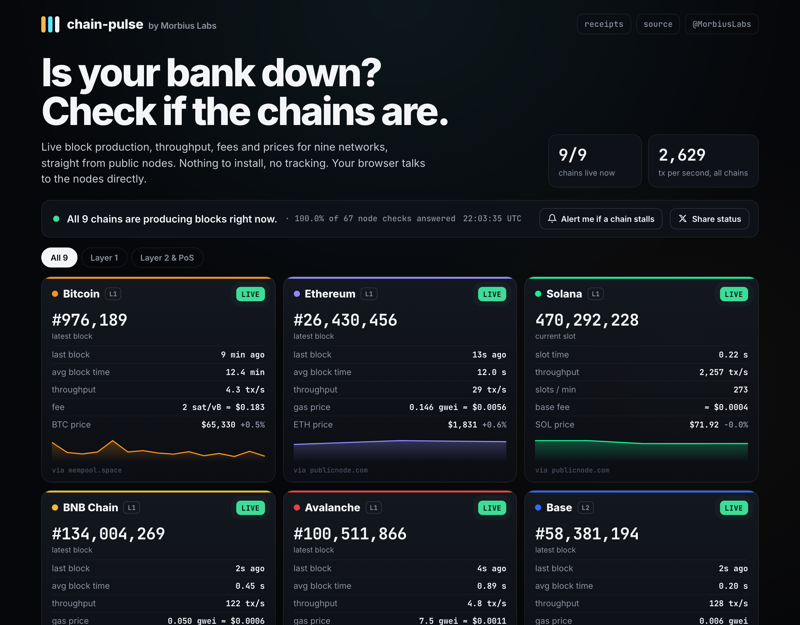

# chain-pulse

**Is your bank down? Check if the chains are.**

Live status for nine networks: Bitcoin, Ethereum, Solana, BNB Chain, Avalanche, Base, Arbitrum, Optimism and Polygon. Blocks, throughput, fees and prices, straight from public nodes, refreshed every few seconds.

**Open it: [morbiuslabs.github.io/chain-pulse](https://morbiuslabs.github.io/chain-pulse/)**

[](https://morbiuslabs.github.io/chain-pulse/)

One HTML file. No build step, no backend, no tracking, no API keys. Your browser talks straight to the public nodes listed below and nothing else.

## Features

- **9 chains at a glance.** Status (LIVE, SLOW, STALLED), latest block, time since it, average block time, throughput in tx/s.
- **Fees in dollars.** Gas price on EVM chains, sat/vB on Bitcoin, base fee on Solana, plus what a simple transfer costs right now on Layer 1s.
- **Prices.** Native token price and 24h change for every chain.
- **Live block feed.** Every new block the page sees, as it lands.
- **24-hour history.** Uptime bars and percentages for every chain, recorded every 5 minutes even when nobody has the page open.
- **Incident log.** Status changes and node failovers during your session, timestamped.
- **Node failover.** Each chain has a primary node and backups. If one fails, the page switches and tells you which node answered.
- **Stall alerts.** Opt in, and your browser notifies you if a chain stops producing blocks while the tab is open.
- **Share status.** One click posts the current state to X.
- **Polite by default.** Polling pauses while the tab is hidden.
- **Embeddable.** A compact widget for your site or dashboard, see below.

## Data sources

| Chain | Data | Primary node | Backups |
|---|---|---|---|
| Bitcoin | last 15 blocks, next-block fee | `mempool.space` | `blockstream.info` |
| Ethereum | latest block, gas price | `ethereum-rpc.publicnode.com` | `1rpc.io` |
| Solana | slot, performance samples | `solana-rpc.publicnode.com` | none yet |
| BNB Chain | latest block, gas price | `bsc-rpc.publicnode.com` | `bsc-dataseed.binance.org` |
| Avalanche C-Chain | latest block, gas price | `avalanche-c-chain-rpc.publicnode.com` | `api.avax.network` |
| Base | latest block, gas price | `base-rpc.publicnode.com` | `mainnet.base.org`, `1rpc.io` |
| Arbitrum One | latest block, gas price | `arbitrum-one-rpc.publicnode.com` | `arb1.arbitrum.io` |
| OP Mainnet | latest block, gas price | `optimism-rpc.publicnode.com` | `mainnet.optimism.io` |
| Polygon PoS | latest block, gas price | `polygon.drpc.org` | `1rpc.io` |

Prices: CoinGecko public API.

## Embed

```html
<iframe src="https://morbiuslabs.github.io/chain-pulse/?embed=1" width="340" height="440" style="border:0;border-radius:14px" title="chain-pulse: live chain status" loading="lazy"></iframe>
```

Free, no key. The widget runs in the visitor's browser and talks to the same public nodes.

## How the history works

A GitHub Actions job ([.github/workflows/pulse.yml](.github/workflows/pulse.yml)) runs [scripts/snapshot.mjs](scripts/snapshot.mjs) every 5 minutes. It checks all nine chains with the same rules as the page and appends one row to `history.json` on the `data` branch, keeping 7 days. The page reads it from `raw.githubusercontent.com` and draws the last 24 hours in 15-minute buckets, each colored by the worst status seen in it.

GitHub runs scheduled jobs on a best-effort basis, so some 5-minute slots can be late or skipped. Those show up as gaps, never as invented data. Anyone can audit the raw file: [history.json](https://github.com/MorbiusLabs/chain-pulse/blob/data/history.json).

## Status rules

- **LIVE**: the newest block is younger than 3x the chain's normal block time, with a 15-second floor for fast chains. Bitcoin: younger than 60 minutes, because its gaps vary a lot.
- **SLOW**: older than that.
- **STALLED**: older than 10x the normal block time, at least 60 seconds. Bitcoin: 2 hours.
- Solana is LIVE when it produced more than 60 slots in the last sampled minute.

A failing node is not proof a chain is down. The card shows "node unreachable" and the incident log records failovers.

## How numbers are computed

- **Throughput**: transactions in the blocks seen, scaled by blocks produced, over the time span. Fast chains are sampled, so treat it as an estimate. Solana uses `getRecentPerformanceSamples`.
- **Transfer cost**: 21,000 gas x gas price x token price on Layer 1 EVM chains. Bitcoin: a 140 vB payment at the next-block rate. Solana: the 5,000-lamport base fee. Layer 2 fees add an L1 data fee, so we show gas price only.

## Run locally

```bash
python3 -m http.server 8000
# open http://localhost:8000
```

## Why

On Nov 16, 2026, Chase, Bank of America, Wells Fargo and U.S. Bank customers reported problems at the same time. Between noon and 3 p.m. ET, Bitcoin added 26 blocks. The full check is in [MorbiusLabs/receipts](https://github.com/MorbiusLabs/receipts).

Made by [@MorbiusLabs](https://x.com/MorbiusLabs), the AI x money news desk that shows its sources. MIT licensed.
